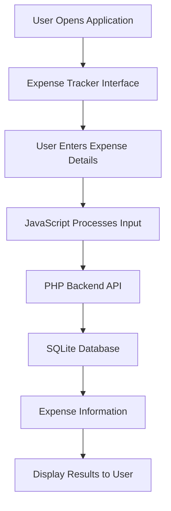

# 💰 Personal Expense Tracker

<p align="center">
  <b>Track Your Money. Control Your Spending. Build Better Habits.</b>
</p>

<p align="center">
  
  
  
  
  
  
</p>

---

## 📌 About the Project

**Personal Expense Tracker** is a simple web-based application designed to help users manage and monitor their daily expenses.

It provides a convenient way to record expenses and keep financial information organized.

The main goal of this project is to encourage better spending habits through easy expense management.

## ✨ Features

- 💵 Record personal expenses.
- 📋 View expense records.
- 📝 Manage expense information.
- 💾 Store expense data using SQLite.
- 🌐 Simple and user-friendly web interface.
- ⚡ Dynamic functionality using JavaScript.
- 🔗 PHP backend for database operations.

## 🛠️ Technologies Used

| Technology | Purpose |
|---|---|
| HTML5 | Webpage structure |
| CSS3 | Styling and layout |
| JavaScript | Frontend functionality |
| PHP | Backend development |
| SQLite | Database management |

## 📂 Project Structure

```text
Personal-Expense-Tracker/
│
├── .gitignore
├── README.md
├── index.html
├── styles.css
├── app.js
├── api.php
│
└── data/
    └── expenses.db
```

## ⚙️ Installation and Setup

Follow these steps to run the project locally.

### 1. Clone the Repository

```bash
git clone https://github.com/sanjanamdinfo/Personal-Expense-Tracker-Web-Application.git
```

### 2. Open the Project

```bash
cd Personal-Expense-Tracker-Web-Application
```

### 3. Set Up the Local Server

- Install XAMPP.
- Copy the project folder into the `htdocs` directory.
- Start Apache from the XAMPP Control Panel.
- Make sure PHP is enabled.

### 4. Run the Application

Open your browser and visit:

```text
http://localhost/Personal-Expense-Tracker-Web-Application/
```

## 🔄 How It Works



## 📸 Screenshots

Add your actual project screenshots here.

### 🏠 Application Dashboard


### 💰 Expense Management


> Note: Create a `screenshots` folder and add your actual screenshots. Update the image names if necessary.

## 🎯 Project Objectives

- Develop a simple expense management application.
- Understand frontend and backend integration.
- Learn database connectivity using PHP and SQLite.
- Improve practical web development skills.
- Practice Git and GitHub version control.

## 🚀 Future Improvements

- 📊 Monthly expense charts.
- 📅 Date-wise expense filtering.
- 🏷️ Expense category management.
- 📥 Export expense reports.
- 📱 Responsive mobile-friendly design.
- 🔐 User authentication.

## 👩‍💻 Developer

**Sanjana M D**

MCA Student | Aspiring Data Science Professional | Web Development Learner

## 🤝 Contributions

Suggestions and improvements are welcome!

If you find an issue or have an idea to improve this project, feel free to create an issue or submit a pull request.

## ⭐ Support

If you find this project useful, consider giving this repository a ⭐ on GitHub!

---

<p align="center">
  <b>Made with ❤️ by Sanjana M D</b>
</p>