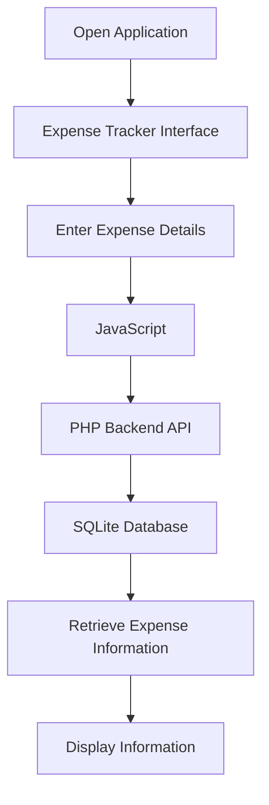

<p align="center">
  
</p>
<h1 align="center">💰 Personal Expense Tracker</h1>

<h3 align="center">Track Your Money. Control Your Spending. Build Better Habits.</h3>

<p align="center">
  A simple and user-friendly web application to manage and monitor daily expenses.
</p>

<p align="center">
  
  
  
  
  
</p>

<p align="center">
  ⭐ If you like this project, consider giving it a star!
</p>

---

## 📌 About the Project

Personal Expense Tracker is a web-based application developed to help users record, organize and monitor their daily expenses.

The application combines a simple frontend with a PHP backend and SQLite database to provide an organized expense-management experience.

### 🎯 Project Goals

- Make daily expense tracking easier.
- Organize personal financial records.
- Understand frontend and backend integration.
- Practice database connectivity.
- Develop practical web development skills.

---

## ✨ Features

| Feature | Description |
|---|---|
| 💰 Expense Tracking | Record personal expenses. |
| 📋 Expense Records | View stored expense information. |
| 📝 Expense Management | Manage expense details. |
| 💾 Data Storage | Store information using SQLite. |
| 🌐 User Interface | Simple web-based interface. |
| ⚡ Dynamic Functionality | JavaScript-powered interactions. |

---

## 🛠️ Technologies Used

| Technology | Purpose |
|---|---|
| HTML5 | Structure of the application |
| CSS3 | Styling and layout |
| JavaScript | Interactive functionality |
| PHP | Backend processing |
| SQLite | Database management |
| Git & GitHub | Version control and project hosting |

---

## 📂 Project Structure

```text
Personal-Expense-Tracker/
│
├── .gitignore
├── README.md
├── index.html
├── styles.css
├── app.js
├── api.php
│
└── data/
    └── expenses.db
```

---

## ⚙️ Installation and Setup

Follow these instructions to run the project locally.

### Step 1: Clone the Repository

```bash
git clone https://github.com/sanjanamdinfo/Personal-Expense-Tracker-Web-Application.git
```

### Step 2: Open the Project Folder

```bash
cd Personal-Expense-Tracker-Web-Application
```

### Step 3: Install Requirements

Make sure you have:

- XAMPP
- PHP
- A web browser
- PHP SQLite support enabled

### Step 4: Configure XAMPP

1. Open the XAMPP Control Panel.
2. Copy the project folder into the `htdocs` directory.
3. Start Apache.
4. Ensure SQLite support is enabled in PHP.

### Step 5: Run the Application

Open your browser and visit:

```text
http://localhost/Personal-Expense-Tracker-Web-Application/
```

---

## 🔄 Application Workflow



---

## 💡 Why This Project?

Managing personal expenses is important for developing good financial habits.

This project provides an opportunity to understand how frontend technologies, backend programming and databases work together in a real-world web application.

---

## 🚀 Future Enhancements

The following improvements can be considered for future versions:

- 📊 Monthly expense charts.
- 📅 Date-wise expense filtering.
- 🏷️ Expense category management.
- 📥 Expense report export.
- 📱 Improved mobile responsiveness.
- 🔐 User authentication.
- 📈 Spending analysis and insights.

---

## 👩‍💻 Developer

<p align="center">
  <b>Sanjana M D</b>
  <br>
  MCA Student | Aspiring Data Science Professional
  <br>
  Interested in Web Development and Data Science.
</p>

<p align="center">
  <a href="https://github.com/sanjanamdinfo">
    
  </a>
</p>

---

## 🤝 Contributions

Suggestions and improvements are welcome!

If you find an issue or have ideas to improve this project, feel free to open an issue or submit a pull request.

---

<h3 align="center">⭐ Support This Project</h3>

<p align="center">
  If you find this project useful, please give it a star on GitHub!
</p>

<h3 align="center">Made with ❤️ by Sanjana M D</h3>